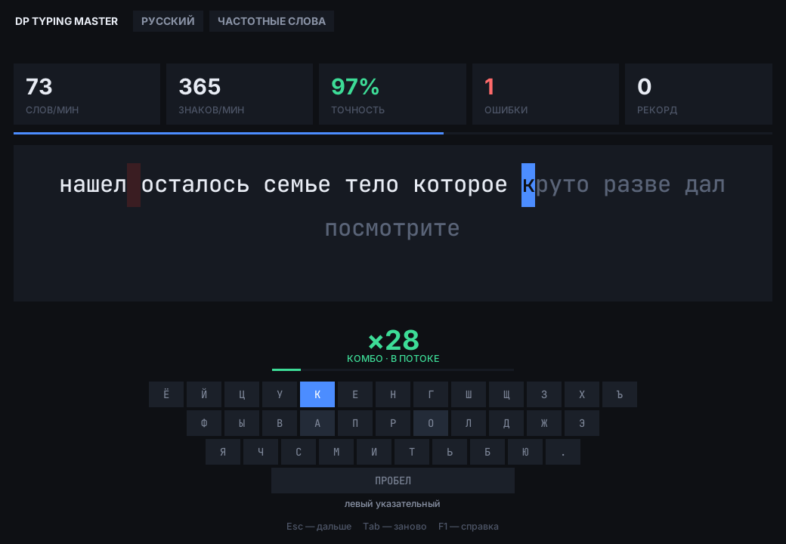
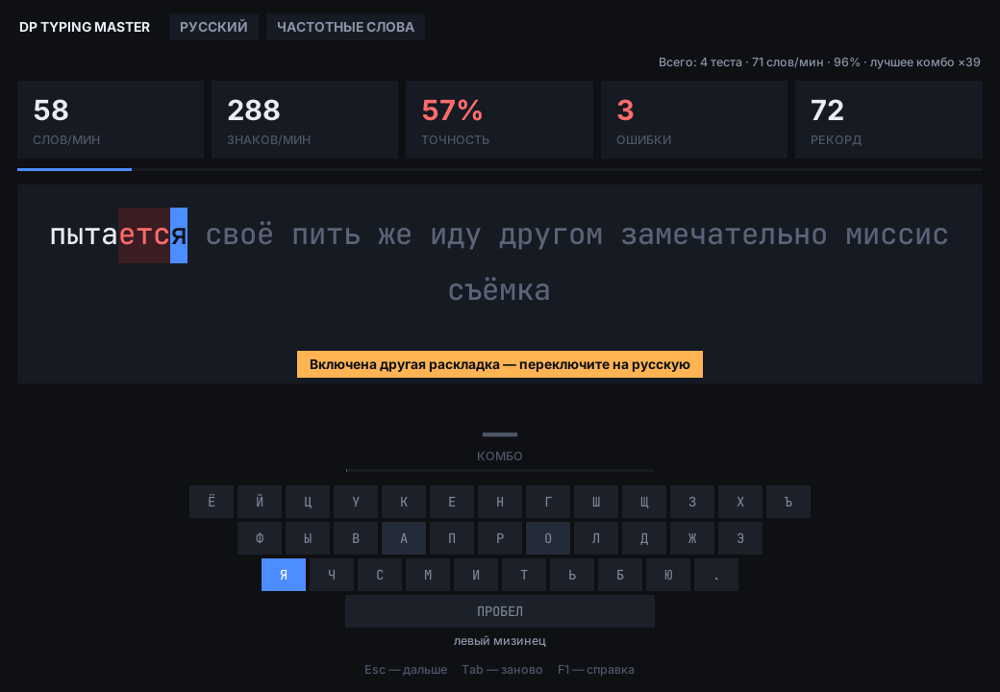
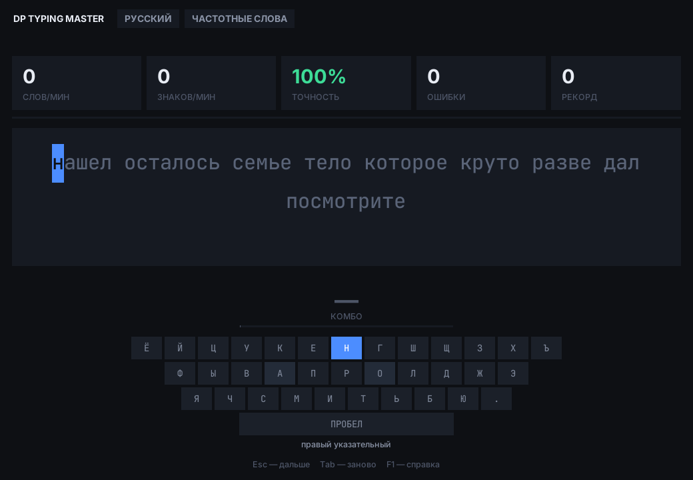
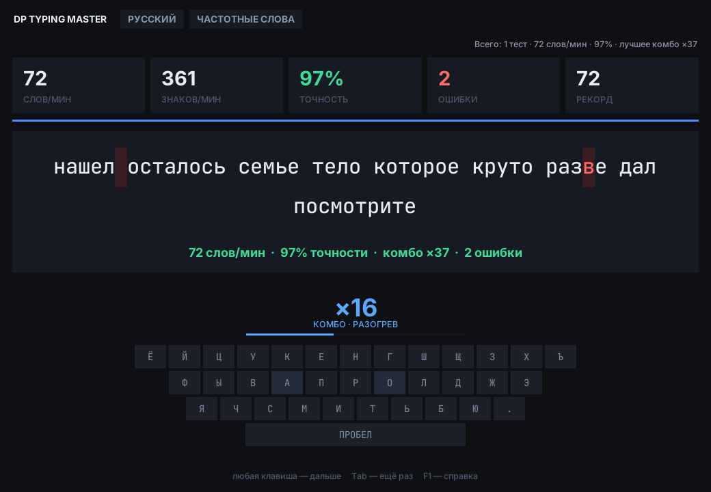
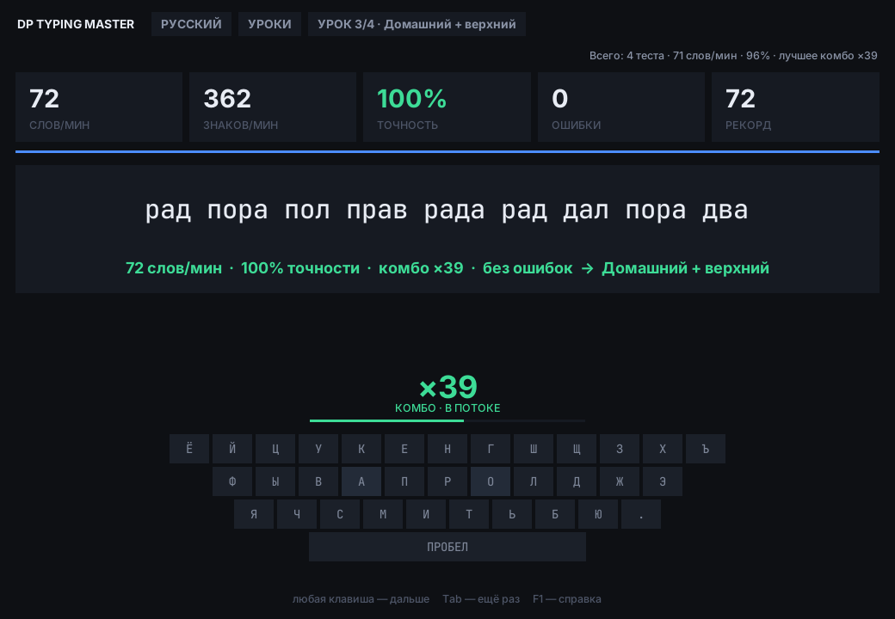
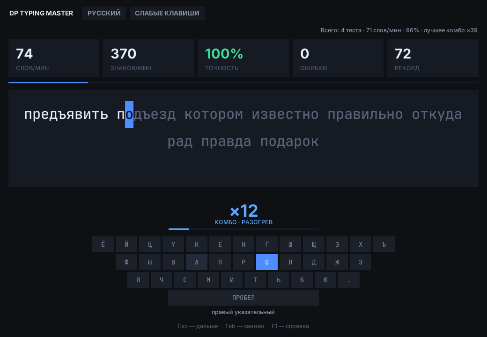
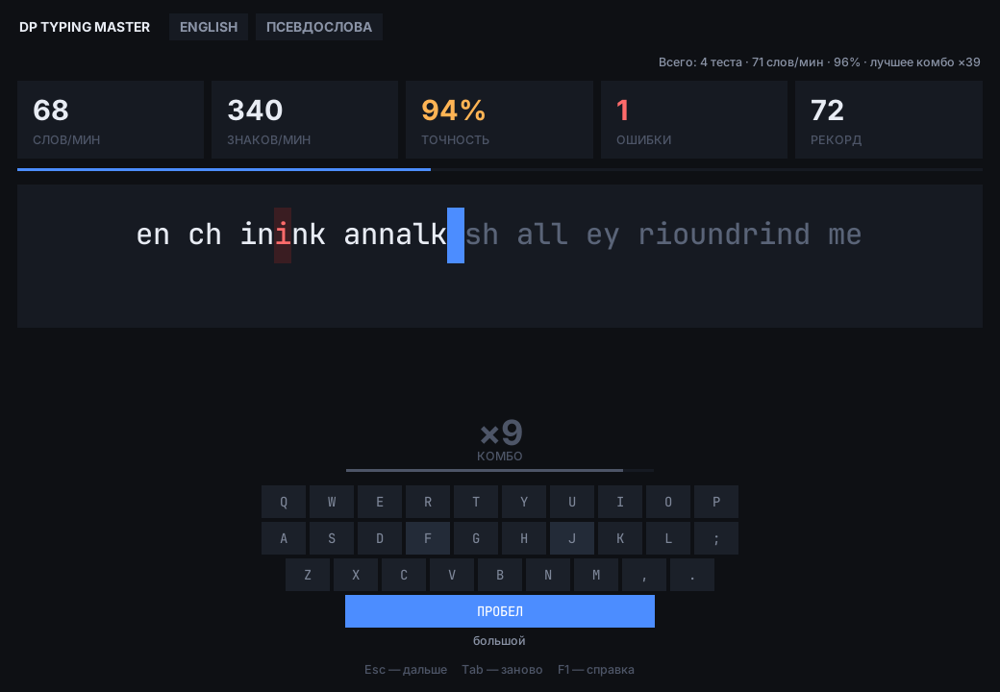
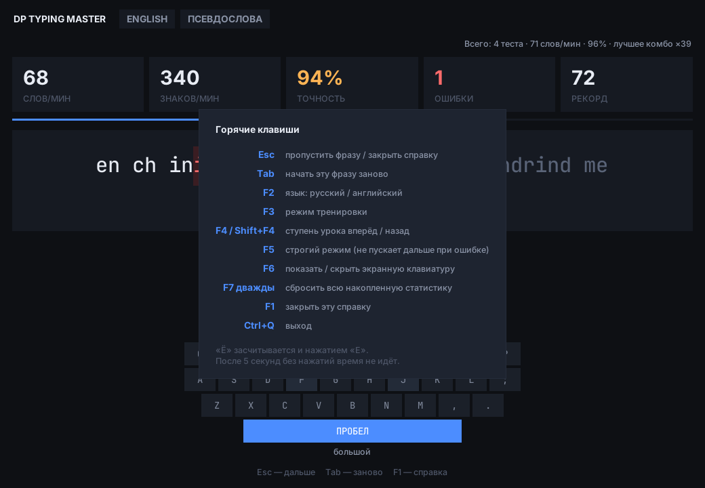
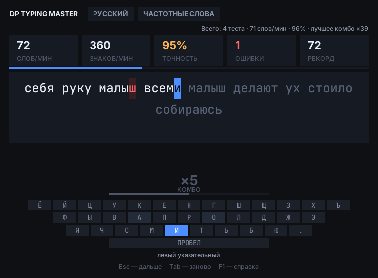

# DP Typing Master

Тренажёр слепой печати для русской и английской раскладки. Без зависимостей —
только Python и tkinter из стандартной библиотеки.



**Что дальше:** [ROADMAP](ROADMAP.md) · [аудит](docs/AUDIT.md) ·
[исследование аналогов](docs/RESEARCH.md) · [изменения](CHANGELOG.md)

## Запуск

```bash
python DP_Typing_Master.py
```

Если Python ругается на отсутствие `tkinter`, поставьте его отдельно:
`sudo apt install python3-tk` (Debian/Ubuntu), `sudo dnf install python3-tkinter`
(Fedora), `sudo pacman -S tk` (Arch). На Windows и macOS он входит в
дистрибутив с python.org.

## Как это работает

Отдельного поля ввода нет: вы печатаете прямо «в текст». Каждый символ
подсвечивается по мере набора — набранное белым, ошибки красным, курсор
синим блоком. Экранная клавиатура снизу показывает следующую клавишу и
подписывает, каким пальцем по ней бить. Итог фразы остаётся на экране,
пока вы не нажмёте любую клавишу.

**Подсказки, а не молчаливые ошибки.** Если в русской тренировке включена
английская раскладка (или наоборот) либо нажат Caps Lock, тренажёр сразу
скажет об этом плашкой. Такие нажатия всё равно считаются ошибками — плашка
лишь объясняет, откуда они.



**Буква «ё»** есть на экранной клавиатуре (левый мизинец), но печатать её
необязательно: «е» на её месте засчитывается как верное нажатие.

### Режимы (F3)

| Режим | Что даёт |
|---|---|
| **Уроки** | Ступени от центра домашнего ряда до полного алфавита. Каждая ступень строго включает предыдущую — пройденные клавиши не пропадают. При точности от 96% ступень повышается сама. |
| **Частотные слова** | Реальная лексика языка: 1200 самых употребимых слов. |
| **Псевдослова** | Несуществующие, но произносимые слова из марковской модели, обученной на той же лексике. Тренируют моторику, не давая угадывать слово по началу. |
| **Слабые клавиши** | Тренажёр считает, на каких буквах вы ошибаетесь, и подбирает слова с ними. На практике даёт примерно втрое больше контакта с проблемными буквами, чем обычный режим. |

### Экраны

| | |
|---|---|
|  |  |
| Первый запуск: курсор на первой букве, на клавиатуре — следующая клавиша и палец | Итог фразы, рекорд и сводка за всё время |
|  |  |
| Урок пройден без ошибок — ступень повысилась сама | «Слабые клавиши»: слова подобраны под ваши ошибки |
|  |  |
| Английская раскладка, псевдослова | Справка по F1 |

В низком окне или при длинной фразе интерфейс сам переходит в компактный
вид, чтобы клавиатура и подсказки оставались целиком видны:



На экранах с масштабом 150–200% вместе со шрифтами растут и все отступы,
клавиши и полоски — ничего не налезает друг на друга.

### Комбо

Счётчик подряд набранных без ошибки символов. Разбивается на уровни
(разогрев → в потоке → разгон → огонь → легенда), каждое попадание даёт
короткую вспышку, полоска показывает путь до следующего уровня. Ошибка
обнуляет комбо; стереть и перенабрать символ, чтобы накрутить счётчик,
не получится.

### Горячие клавиши

| Клавиша | Действие |
|---|---|
| `Esc` | пропустить фразу; закрыть справку |
| `Tab` | эту же фразу заново |
| `F1` | справка |
| `F2` | русский / английский |
| `F3` | режим тренировки |
| `F4` / `Shift+F4` | ступень урока вперёд / назад; вне уроков — открыть уроки |
| `F5` | строгий режим — не пускает дальше, пока символ не набран верно |
| `F6` | показать / скрыть экранную клавиатуру |
| `F7` дважды | сбросить накопленную статистику (одно нажатие только спрашивает) |
| `Ctrl+Q` | выход |

Прогресс, рекорды и статистика по буквам сохраняются между запусками
(`~/.config/dp-typing-master/profile.json` или аналог для вашей ОС).

## Метрики

**Точность** считается по нажатиям, а не по итоговому тексту: опечатка,
исправленная бэкспейсом, остаётся в статистике. **Скорость** измеряется от
первого нажатия до последнего и ограничена сверху 1500 знаков/мин — всё,
что выше, это вставка из буфера, а не человек. Время берётся с монотонных
часов, поэтому синхронизация системного времени не искажает результат.

**Пауза.** После 5 секунд без нажатий время перестаёт идти, а на экране
появляется «пауза»; следующее нажатие продолжает тест. Отошли посреди
фразы — скорость не пострадает.

**Засчитываются только дописанные фразы.** Пропущенная (`Esc`), начатая
заново (`Tab`) или брошенная при выходе фраза не идёт в число тестов и в
среднюю скорость, но её ошибки учитываются в режиме «Слабые клавиши».

## Разработка

```bash
pytest                                   # логика: работает без дисплея
xvfb-run -a pytest                       # плюс интеграционные тесты на настоящем Tk
DP_REQUIRE_GUI=1 xvfb-run -a pytest      # как в CI: без дисплея — ошибка, а не пропуск
ruff check . && flake8 .
```

CI (GitHub Actions) гоняет линтеры и все тесты под Xvfb на Python 3.9–3.13.

Скриншоты для документации пересобираются одной командой (нужен ImageMagick):

```bash
xvfb-run -a -s "-screen 0 1280x900x24" python tools/screenshots.py docs/screenshots
```

Логика (`engine.py`, `words.py`, `layout.py`, `storage.py`) не импортирует
tkinter и проверяется headless. Интерфейс (`app.py`) покрыт отдельными
тестами, которые поднимают реальное окно и стучат по нему клавишами; без
дисплея они пропускаются.

Замеренное на настоящем Tk: стоимость одного нажатия не зависит от длины
фразы (при удлинении текста в 26 раз — ×0.94), тогда как перебор всей
строки на каждое нажатие рос бы в ×7.1. В покое очередь отложенных задач
пуста — это проверяется тестом.

Требуется Python 3.9+; проверяется в CI на 3.9, 3.10, 3.11, 3.12 и 3.13.

## Лицензия

GPL-3.0-or-later, см. [LICENSE](LICENSE). Происхождение словарей описано в
[`dp_typing/data/SOURCES.md`](dp_typing/data/SOURCES.md).
